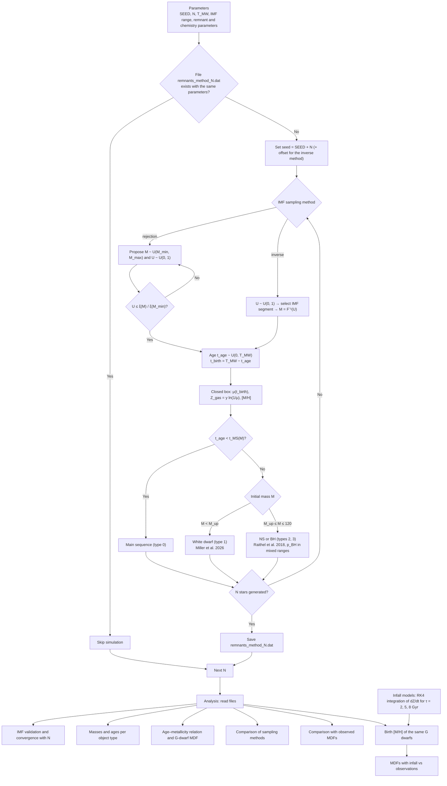

# MW_Stellar_population

Monte Carlo synthesis of the stellar population of the Milky Way (MW). Each star is described by its initial mass, age, birth metallicity and present-day evolutionary state (main sequence, white dwarf, neutron star or black hole). The simulated G dwarfs are compared with observed metallicity distribution functions (MDFs) of the solar neighbourhood, using a closed-box model and models with gas infall.

Project 3 of the course on computational astrophysics, Departamento de Física, Universidad Técnica Federico Santa María (UTFSM), 2026.

**Authors:** Benjamín Carrillo Carrasco, [co-author]

---

## Repository structure

```
MW_Stellar_population/
├── README.md
├── LICENSE
├── MW_population_synthesis.ipynb   # simulation and analysis
├── observed_mdf/                   # observed MDFs, one [X/H] value per line
│   ├── MDF_obs_Haywood2001_FeH.dat
│   ├── MDF_obs_GCS3_FeH.dat
│   ├── MDF_obs_Adibekyan2012_FeH.dat
│   └── MDF_obs_Adibekyan2012_MgH.dat
└── figures/                        # figures of the paper
```

The simulation files (`remnants_{method}_N{N}.dat`) are not included because of their size (≈50 MB each for N = 10⁶). They are regenerated by the notebook with the same random seed, so the results are fully reproducible.

## Requirements

- Python ≥ 3.9
- `numpy`
- `matplotlib`

```bash
pip install numpy matplotlib
```

## Usage

Open `MW_population_synthesis.ipynb` and run all the cells in order. The notebook has two parts:

1. **Models and simulation.** Parameters, IMF sampling, remnant prescriptions, the simulation loop and the chemical evolution models. Each simulation is saved to `remnants_{method}_N{N}.dat`. If a file already exists and was generated with the same parameters, it is skipped, so re-running the notebook is fast.
2. **Analysis and figures.** These cells only read the saved files and the observed MDFs; no new simulations are run.

Approximate runtime for N = 10⁶: ≈21 min with rejection sampling and ≈5 s with the inverse transform method. All the other population sizes take less than 3 min in total.

To change a parameter, edit the parameters cell and run the notebook again. Only the simulations affected by the change are regenerated. Set `REDO = True` to force all the simulations to run again.

## Flowchart



## Parameters

| Parameter | Value | Description |
|---|---|---|
| `SEED` | 12345 | Base random seed |
| `REDO` | `False` | If `True`, simulations are run again even if the files exist |
| `n` | 10, 10², …, 10⁶ | Population sizes (one independent simulation each) |
| `METHOD` | `'rejection'` | IMF sampling method: `'rejection'` or `'inverse'` |
| `M_min`, `M_max` | 0.08, 120 M☉ | IMF mass range |
| `T_MW` | 10 Gyr | Age of the MW |
| `u_f` | 0.1 | Final gas fraction μ_f |
| `Z_sun` | 0.014 | Solar metallicity |
| `y` | Z☉ / ln(1/μ_f) | Effective yield (closed box) |
| `M_up` | 9 M☉ | WD–NS transition mass |
| `f_ej` | 0.9 | Envelope ejection fraction for BHs (Raithel et al. 2018, Eq. 4) |
| `p_BH_15_217` | 0.4 | BH probability for 15–21.7 M☉ |
| `p_BH_252_275` | 0.25 | BH probability for 25.2–27.5 M☉ |
| `p_BH_60_120` | 0.6 | BH probability for 60–120 M☉ |
| `NS_gravitational` | `True` | Convert NS baryonic masses into gravitational masses |
| `R_NS` | 12 km | NS radius |
| `M_G_min`, `M_G_max` | 0.8, 1.05 M☉ | G-dwarf mass range |
| `bins_FeH` | −2.5 to 0.7, step 0.1 | Bins of the MDFs |
| `metal_poor_threshold` | −0.5 | [Fe/H] below which a star is metal-poor |
| `tau_infall_list` | 2, 5, 8 Gyr | Infall timescales |
| `M_0_infall` | 0.1 | Initial gas mass, in units of M_tot(T_MW) |
| `Z_in` | 0 | Metallicity of the accreted gas |
| `recalibrate_yield` | `True` | Adjust y so that Z_gas(T_MW) = Z☉ in each infall model |
| `n_t_chem` | 20001 | Time steps of the RK4 integration |

## Functions

### Simulation

| Function | Input | Output | Description |
|---|---|---|---|
| `simulation_seed(N, method)` | N, method | int | Random seed of each simulation |
| `parameter_signature(method)` | method | str | Parameters written in the file header, used to detect outdated files |
| `IMF(m)` | mass [M☉] | ξ(m) | Kroupa (2001) IMF, not normalized |
| `inverse_transform_mass(U)` | U ∈ [0, 1) | mass [M☉] | Initial mass from the inverse cumulative IMF |
| `simulate_population(N, method)` | N, method | masses, ages, birth times, [M/H], iterations | Generates N stars |
| `t_MS(M)` | mass [M☉] | t_MS [Gyr] | Main-sequence lifetime, 10 Gyr · M^−2.5 |
| `WD_mass(M)` | initial mass | WD mass | Miller et al. (2026), Full Sample Fit 1, Eqs. 6–9 |
| `NS_baryonic_mass(M)` | initial mass | baryonic NS mass | Raithel et al. (2018), Eqs. 10–15 and branch VII |
| `NS_gravitational_mass(M_b)` | baryonic mass | gravitational mass | Raithel et al. (2018), Eqs. 19–20, solved iteratively |
| `NS_mass(M)` | initial mass | NS mass | Baryonic or gravitational, depending on `NS_gravitational` |
| `BH_mass(M)` | initial mass | BH mass | Raithel et al. (2018), Eqs. 1–4, linear interpolation for 40–45 M☉ |
| `remnant(M, t_age)` | mass, age | (type, final mass) | Evolutionary state of a star |
| `file_up_to_date(N, method)` | N, method | bool | Checks if a simulation file exists with the current parameters |
| `population_synthesis(method)` | method | files | Simulates and saves all the population sizes in `n` |
| `chemical_evolution(tau, M_0, ...)` | τ, M_0 | dict with t, Z, M_gas, M_tot, A, y | One-zone model with exponential infall, integrated with RK4 |
| `birth_MH(model, age)` | model, ages | [M/H] | Birth metallicity of stars in a chemical evolution model |

### Analysis

| Function | Input | Output | Description |
|---|---|---|---|
| `list_N(method)` | method | list of N | Population sizes with a saved file |
| `load_simulation(N, method)` | N, method | M, age, [M/H], type, M_rem, iterations | Reads a simulation file |
| `read_runtime(N, method)` | N, method | runtime [s] | Runtime stored in the file header |
| `MDF_summary(data)` | [X/H] values | dict | Normalized histogram, peak, median, σ, f(<−0.5), f(>0) |

## Output files

Each simulation is saved to `remnants_{method}_N{N}.dat`, with a 4-line header (parameters, iterations and runtime, column names, type codes) and the columns:

| Column | Units | Description |
|---|---|---|
| `M` | M☉ | Initial mass |
| `age` | Gyr | Age |
| `[M/H]` | dex | Birth metallicity (closed box) |
| `type` | – | 0 = MS, 1 = WD, 2 = NS, 3 = BH, −1 = no relation |
| `M_rem` | M☉ | Present-day mass (initial mass for MS stars) |

## Figures

| File | Content |
|---|---|
| `IMF_vs_N.png` | Simulated mass distribution vs Kroupa IMF for each N |
| `CONVERGENCE.png` | Number and fraction of each object type vs N |
| `MASSES.png` | Initial and final mass distributions per object type |
| `AGES.png` | Age distribution per object type |
| `AGE-METALLICITY.png` | Age–metallicity relation for each N |
| `MDF.png` | Simulated G-dwarf MDF vs analytic closed box |
| `SAMPLING_METHODS.png` | Comparison of rejection and inverse transform sampling |
| `MDF_MODEL_VS_OBS.png` | Closed-box MDF vs observed MDFs |
| `INFALL_EVOLUTION.png` | Accretion rate, gas fraction and gas metallicity of the infall models |
| `MDF_INFALL.png` | G-dwarf MDFs of the infall models vs observations |

## Observed data

The files in `observed_mdf/` contain the [Fe/H] or [Mg/H] values of the following samples, obtained from VizieR:

- Haywood (2001), MNRAS 325, 1365: 218 long-lived dwarfs (`J/MNRAS/325/1365`)
- Geneva–Copenhagen Survey III, Holmberg et al. (2009), A&A 501, 941: 16394 stars (`V/130`)
- Adibekyan et al. (2012), A&A 545, A32: 1111 FGK stars, [Fe/H] and [Mg/H] (`J/A+A/545/A32`)

## References

- Kroupa, P. 2001, MNRAS, 322, 231
- Miller, D. R., et al. 2026, ApJ, 996, 69
- Raithel, C. A., Sukhbold, T., & Özel, F. 2018, ApJ, 856, 35
- Chiappini, C., Matteucci, F., & Gratton, R. 1997, ApJ, 477, 765
- Tinsley, B. M. 1980, Fundamentals of Cosmic Physics, 5, 287

## Use of AI tools

The analysis section of the notebook was written with the help of Claude Code for efficiency. The simulation section was optimized with Claude, but the structure and logic of the infall model and of the remnant assignment are the authors' own.
